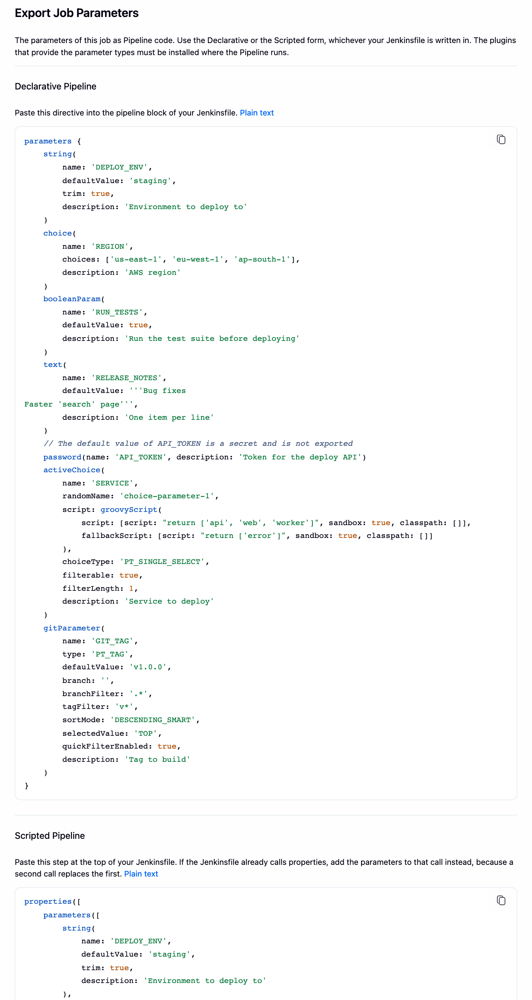

# Export Job Parameters Plugin

Exports the parameters of a job as Pipeline code, so you can move a job that was configured in the UI to a `Jenkinsfile` without retyping its parameters.

## Usage

Every job that has parameters gets an **Export Job Parameters** link in its side panel. The page shows the parameters in both Pipeline flavors, each with a copy button.



The link is shown to users who can read the job configuration (`Job/Configure` or `Job/ExtendedRead`).

For a job with a string, a choice and a boolean parameter you get a `parameters` directive for a Declarative Pipeline:

```groovy
parameters {
    string(name: 'DEPLOY_ENV', defaultValue: 'staging', description: 'Where to deploy')
    choice(name: 'REGION', choices: ['us-east-1', 'eu-west-1'], description: 'AWS region')
    booleanParam(name: 'DEBUG', defaultValue: true)
}
```

and a `properties` step for a Scripted Pipeline:

```groovy
properties([
    parameters([
        string(name: 'DEPLOY_ENV', defaultValue: 'staging', description: 'Where to deploy'),
        choice(name: 'REGION', choices: ['us-east-1', 'eu-west-1'], description: 'AWS region'),
        booleanParam(name: 'DEBUG', defaultValue: true)
    ])
])
```

### From a script

Both forms are also served as plain text, which helps when you have many jobs to move:

```sh
curl -u user:token https://jenkins.example.com/job/my-job/export-parameters/declarative
curl -u user:token https://jenkins.example.com/job/my-job/export-parameters/scripted
```

## Supported parameters

The code is generated by the same engine as the Pipeline Syntax snippet generator, so any parameter type that works in Pipeline is exported, including the ones contributed by other plugins such as [Active Choices](https://plugins.jenkins.io/uno-choice/):

```groovy
activeChoice(
    name: 'SERVICE',
    randomName: 'choice-parameter-751738021191326',
    script: groovyScript(
        script: [script: "return ['api', 'web', 'worker']", sandbox: true, classpath: []],
        fallbackScript: [script: "return ['error']", sandbox: true, classpath: []]
    ),
    choiceType: 'PT_SINGLE_SELECT',
    filterable: true,
    filterLength: 1,
    description: 'Service to deploy'
)
```

The code is laid out to be read: the name comes first and the description last, a parameter that does not fit on one line is written with one argument per line, and strings use the quotes that need the least escaping.

Things to know:

- A parameter type without a Pipeline symbol is written as `[$class: '...']`. Declarative Pipeline does not accept that form, so for such a job only the Scripted Pipeline code is offered.
- Default values of password parameters are not exported. A secret does not belong in a `Jenkinsfile`; use a credential instead.
- A parameter type that Pipeline cannot instantiate at all is replaced by a comment naming it.

Each release is checked by running a Pipeline from the generated code and comparing the parameter it creates with the original one, for the parameter types of Jenkins core and of these plugins: Active Choices, Git Parameter, Extended Choice Parameter, Credentials, Validating String Parameter, Node and Label parameter, Persistent Parameter, List Git Branches Parameter, Hidden Parameter, Parameter Separator, File Parameters, Extensible Choice Parameter, Date Parameter, Mask Passwords, Subversion, Multiselect parameter, Image Tag Parameter, Jira and Custom Checkbox Parameter.

## Requirements

Jenkins 2.555.3 or newer and the [Pipeline: Groovy](https://plugins.jenkins.io/workflow-cps/) plugin.

## Issues

Report issues and enhancements in the [GitHub issue tracker](https://github.com/jenkinsci/export-job-parameters-plugin/issues).

## Contributing

Refer to our [contribution guidelines](https://github.com/jenkinsci/.github/blob/master/CONTRIBUTING.md).

Run `mvn hpi:run` to try the plugin on a local Jenkins at <http://localhost:8080/jenkins/>, and `mvn verify` before opening a pull request.

## License

Licensed under MIT, see [LICENSE](LICENSE.md).
